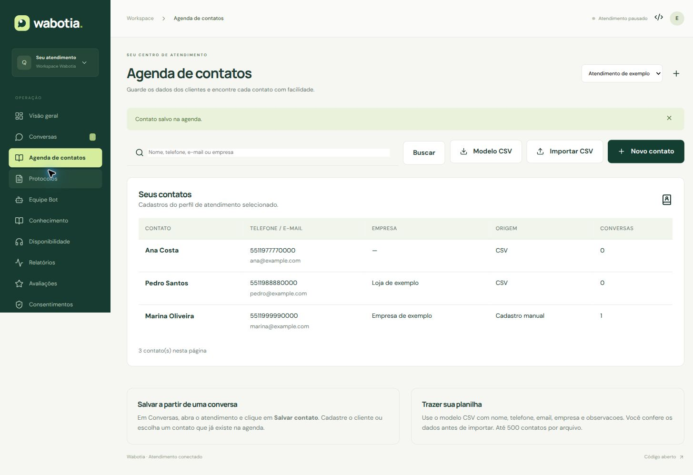
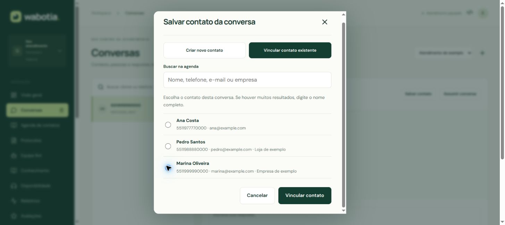
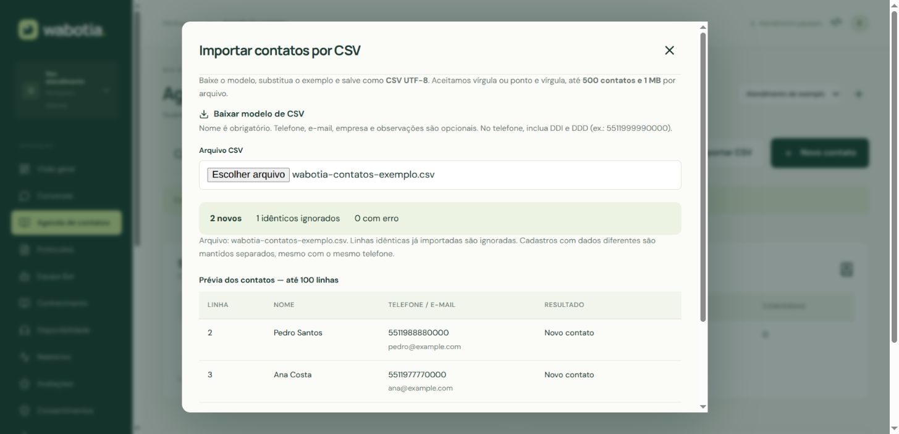

# Agenda de contatos

Disponível a partir da versão **0.4.0**. Se o menu não aparecer, abra **Sistema e atualizações → Verificar atualização → Atualizar Wabotia**. Depois clique em **Reabrir painel atualizado**.

## Criar e encontrar um contato

1. Entre no painel e selecione o **perfil de atendimento** no alto da tela.
2. Abra **Agenda de contatos → Novo contato**.
3. Preencha o nome. Telefone, e-mail, empresa e observações são opcionais.
4. No telefone, informe DDI e DDD: por exemplo, `5511999990000`. Pode usar `+55 (11) 99999-0000`; o sistema guarda os dígitos. Ele não acrescenta o código do país por conta própria.
5. Clique em **Salvar contato**. Para editar, clique no nome na agenda.

Busque por nome, telefone, e-mail ou empresa e clique em **Buscar**. A busca de nomes ignora acentos. Se houver mais registros, use **Próxima página**. Ao abrir um contato, você também pode abrir suas conversas vinculadas mais recentes.

## Salvar o cliente de uma conversa

1. Abra **Conversas** e selecione o atendimento.
2. Clique em **Salvar contato**. O telefone da conversa é preenchido quando está disponível.
3. Escolha **Criar novo contato** e informe o nome, ou **Vincular contato existente** e selecione uma pessoa da agenda.
4. Salve. O nome passa a aparecer no atendimento e na lista de conversas.
5. Use **Editar contato** para corrigir os dados. As alterações valem para todas as conversas vinculadas ao cadastro.

Se escolheu a pessoa errada, abra **Editar contato → Desvincular desta conversa**, depois salve o contato correto. Desvincular mantém o cadastro e o histórico. A agenda não une clientes automaticamente pelo telefone. Você pode vincular explicitamente várias conversas ao mesmo contato.

## Importar uma planilha CSV

1. Na agenda, clique em **Modelo CSV** e abra o arquivo no Excel, LibreOffice ou Google Planilhas.
2. Mantenha a primeira linha com as colunas `nome`, `telefone`, `email`, `empresa`, `observacoes`. Substitua a linha de exemplo pelos seus dados. Só o nome é obrigatório.
3. Formate a coluna de telefone como **Texto** antes de preencher. Use o número completo com DDI e DDD, sem fórmula ou notação científica. Não altere os títulos das colunas.
4. Salve ou baixe como **CSV UTF-8**, separado por vírgula ou ponto e vírgula. No Excel, use **Arquivo → Salvar como → CSV UTF-8**. No Google Planilhas, use **Arquivo → Fazer download → Valores separados por vírgulas (.csv)**. No LibreOffice, escolha **Texto CSV**, conjunto de caracteres UTF-8 e delimitador vírgula ou ponto e vírgula. Arquivos `.xlsx` precisam ser convertidos para CSV.
5. Use até **500 contatos e 1 MB por arquivo**. Para uma agenda maior, divida a planilha em arquivos menores e mantenha o cabeçalho em cada um.
6. Clique em **Importar CSV**, selecione o arquivo e confira a prévia. Veja quantos contatos são novos, quantas linhas idênticas serão ignoradas e os erros por linha.
7. Se houver erro, **nenhum contato será importado**. Corrija o arquivo, salve e selecione-o novamente. Quando estiver correto, clique em **Importar N contato(s)**.

O sistema ignora linhas com todos os campos normalizados idênticos, tanto no mesmo arquivo quanto em arquivos anteriormente importados no mesmo perfil. Uma repetição não sobrescreve um contato que você já editou. Se qualquer dado for diferente, será criado outro cadastro; contatos com o mesmo telefone não são mesclados. Para corrigir um cadastro, edite-o na agenda.

A importação não envia mensagens, não abre conversas e não autoriza contatos de marketing. Janelas de atendimento, consentimentos e templates continuam seguindo as regras do canal.

## Perfis e integrações

Atendentes acessam apenas os perfis autorizados. Cada integração externa tem sua própria agenda dentro dos perfis permitidos; ela não acessa contatos de outras integrações nem os cadastros compartilhados da equipe. O administrador ou atendente autorizado pode consultar esses contatos e vê a indicação **Integração externa**.

Para salvar ou vincular a partir de uma conversa externa, o contato deve pertencer à mesma integração. A API não permite escolher o autor ou mudar essa separação. Os novos endpoints e exemplos estão em [API](API.md#agenda-de-contatos) e no [OpenAPI interativo](https://wabotia.queven.app/api-docs).
