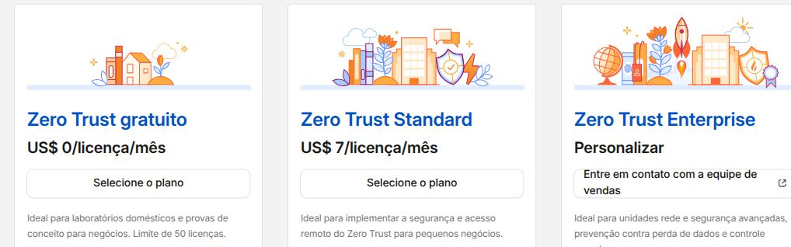
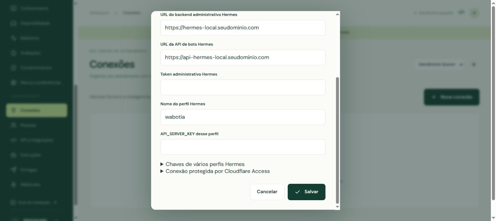

# Hermes, API e Cloudflare: do serviço desligado à conexão

O Wabotia já deve estar instalado. **Não gere outra MASTER_KEY nem execute novamente a instalação do Worker.** Aqui você vai ligar dois serviços nativos do Hermes e permitir que o seu Wabotia os alcance. O painel continua hospedado na Cloudflare.

Antes de começar, confira os [requisitos da conta e a função de cada serviço Cloudflare](INSTALACAO.md#antes-do-deploy-para-que-serve-cada-serviço-da-cloudflare). R2 precisa de assinatura ativada mesmo com franquia gratuita; D1 está incluído nos planos Workers; Zero Trust precisa estar ativado para usar Access neste roteiro. Se já ativou Zero Trust, apenas confirme o acesso às aplicações na etapa C.

Siga nesta ordem: **A. preparar Hermes → B. testar localmente → C. ativar Zero Trust → D. proteger os endereços → E. criar o túnel → F. cadastrar no Wabotia**. A etapa G ensina a religar os serviços.

## A. Escolha onde o Hermes está

| Instalação | Onde digitar os comandos | Caminho deste guia |
|---|---|---|
| Ubuntu/Linux nativo | Terminal da própria máquina, com o usuário do Hermes | A1 |
| Windows/WSL2 | Terminal Ubuntu do WSL onde o Hermes foi instalado | A1; o WSL precisa continuar ligado |
| macOS nativo | Terminal do Mac | A1, usando o comando em primeiro plano no lugar de systemd |
| VPS Ubuntu com Docker | Terminal da VPS, por SSH ou pelo painel da Hostinger | A2 |

**Os endereços de exemplo precisam ser substituídos pelo seu domínio ativo na Cloudflare.** Use nomes diferentes para cada máquina. Não aponte os nomes local e VPS para a mesma instalação por acidente.

| Campo | Computador local | VPS |
|---|---|---|
| Nome do túnel novo | `wabotia-hermes-local` | `wabotia-hermes-vps` |
| Backend administrativo | `hermes-local.seudominio.com` | `hermes-vps.seudominio.com` |
| API dos bots | `api-hermes-local.seudominio.com` | `api-hermes-vps.seudominio.com` |
| Perfil Hermes deste exemplo | `wabotia` | `wabotia` |

### A1. Hermes nativo: crie o perfil e ligue a API

1. Abra o terminal **com o mesmo usuário que instalou o Hermes**, sem `sudo` nos comandos Hermes. Confirme que `hermes --help` funciona.
2. Baixe o código do Wabotia se ainda não tiver uma cópia. Se já tiver, abra a pasta existente e atualize-a pelo Git antes de usar o assistente; não clone por cima da instalação.

```sh
git clone https://github.com/Quevenapp/Wabotia.git
cd Wabotia
```

3. Cole o comando abaixo. Troque apenas os dois endereços pelo seu domínio. `--create-profile` cria `wabotia` se ele ainda não existir; se existir, preserva o perfil.

```sh
python3 scripts/prepare-hermes.py --profile wabotia --create-profile \
  --admin-hostname hermes-local.seudominio.com \
  --api-hostname api-hermes-local.seudominio.com
```

O assistente faz backup privado, gera chaves quando ausentes e configura `gateway.api_server.enabled=true`, `host=127.0.0.1`, `port=8642` no gateway compartilhado. Cada perfil tem sua própria `API_SERVER_KEY`. A chave do `default`, necessária ao listener compartilhado, **não é entregue ao Wabotia**. Canais, histórico e bots existentes são preservados. O assistente recusa perfis pausados e instalações com `gateway.multiplex_profiles=false`; não altere esse modo sem revisar seu gateway.

**API estava desligada?** O comando acima habilita a configuração; o próximo passo inicia os processos. Criar uma chave sozinho não liga o serviço.

4. Em Ubuntu/Linux com serviço de usuário já instalado, use:

```sh
mkdir -p ~/.config/systemd/user
install -m 600 ~/.config/wabotia/hermes/hermes-wabotia-admin.service \
  ~/.config/systemd/user/hermes-wabotia-admin.service
systemctl --user daemon-reload
systemctl --user enable --now hermes-wabotia-admin.service
systemctl --user restart hermes-gateway.service
```

O reinício do gateway interrompe brevemente os canais que ele atende; faça-o fora de um atendimento em andamento. **Se aparecer “Unit hermes-gateway.service not found”**, o seu Hermes não usa esse serviço. Use o gerenciador pelo qual ele já é iniciado. Se não houver gateway instalado, veja `hermes gateway install --help` e instale o serviço nativo, ou mantenha `hermes gateway run` em um terminal. Não inicie um segundo gateway em paralelo.

5. Se quiser manter serviços de usuário após sair da sessão Ubuntu, habilite uma vez:

```sh
sudo loginctl enable-linger "$USER"
```

6. **macOS ou execução manual:** em um terminal separado, rode o comando abaixo e deixe-o aberto. Reinicie o gateway pelo método já usado no Hermes. Para iniciar automaticamente no Mac, registre esse mesmo comando no launchd conforme o gerenciamento local. Fechar o terminal encerra esse backend.

```sh
python3 scripts/prepare-hermes.py --serve-admin
```

7. Abra o perfil `wabotia` no Hermes e confira **modelo, provedor e autenticação**. Um perfil novo pode herdar a escolha do modelo, mas isso não garante acesso ao provedor. Use `hermes -p wabotia model` para selecionar/configurar o modelo. Não copie tokens de WhatsApp ou Telegram de outros perfis.

### A2. VPS Ubuntu com Hermes em Docker

Este roteiro usa a **imagem oficial atual com usuário `hermes`, dados em `/opt/data` e rede `host`**, configuração disponível no Compose oficial para Linux. Primeiro confira sua instalação; não substitua seu Compose nem seus volumes pelos de um tutorial. A sequência foi revisada contra a imagem/documentação local do Hermes; a execução na sua VPS ainda precisa ser validada.

1. Entre na VPS e identifique o contêiner do gateway:

```sh
docker ps --format 'table {{.Names}}\t{{.Status}}\t{{.Image}}'
docker inspect -f '{{.HostConfig.NetworkMode}}' hermes
docker inspect -f '{{range .Mounts}}{{println .Source "->" .Destination}}{{end}}' hermes
```

Neste exemplo o nome é `hermes`. Substitua-o em **todos** os comandos se o seu for diferente. O segundo comando precisa indicar `host` para seguir este roteiro. O terceiro deve mostrar o volume persistente `/opt/data`. **Não use `docker compose down -v`.** Se a rede for `bridge`, `127.0.0.1` do host não é o contêiner: adapte a implantação com uma rede privada compartilhada e autenticação compatível antes de continuar. Abrir portas no firewall não resolve essa diferença.

2. Salve um backup do volume Hermes e do Compose existente. Na VPS, baixe a pasta Wabotia e copie o assistente para o contêiner:

```sh
git clone https://github.com/Quevenapp/Wabotia.git
cd Wabotia
docker cp scripts/prepare-hermes.py hermes:/tmp/wabotia-prepare-hermes.py
docker exec --user hermes hermes python3 /tmp/wabotia-prepare-hermes.py \
  --output /opt/data/wabotia-connection --profile wabotia --create-profile \
  --admin-hostname hermes-vps.seudominio.com \
  --api-hostname api-hermes-vps.seudominio.com
docker exec --user hermes hermes cp /tmp/wabotia-prepare-hermes.py \
  /opt/data/wabotia-connection/prepare-hermes.py
```

O arquivo em `/tmp` é só a cópia inicial. A última linha preserva o assistente no volume. Se a imagem não tiver Python, esse usuário ou a CLI compatível, pare e revise a imagem utilizada; não execute modificações como root para contornar permissões.

3. Escolha um momento sem atendimento e reinicie **o contêiner existente** para a API ler a configuração:

```sh
docker restart hermes
```

4. Para manter o backend administrativo separado e ligado após reinícios, crie `/etc/systemd/system/hermes-wabotia-admin.service` na VPS, por exemplo com `sudo nano /etc/systemd/system/hermes-wabotia-admin.service`. Cole:

```ini
[Unit]
Description=Hermes administrativo para Wabotia em Docker
After=docker.service
Requires=docker.service

[Service]
Type=simple
ExecStart=/usr/bin/docker exec --user hermes hermes python3 /opt/data/wabotia-connection/prepare-hermes.py --output /opt/data/wabotia-connection --serve-admin
Restart=always
RestartSec=10

[Install]
WantedBy=multi-user.target
```

Confira `command -v docker` e ajuste `/usr/bin/docker` se necessário. O serviço executa somente o backend administrativo **dentro do contêiner existente**. Não cria outro gateway. A porta 9119 precisa estar livre. Se já estiver ocupada, prepare com `--admin-port 9120` e use 9120 também no túnel.

```sh
sudo systemctl daemon-reload
sudo systemctl enable --now hermes-wabotia-admin.service
docker exec --user hermes hermes python3 /opt/data/wabotia-connection/prepare-hermes.py \
  --output /opt/data/wabotia-connection --check
```

5. Guarde as chaves em local privado no host, sem imprimi-las no terminal:

```sh
mkdir -p ~/.config/wabotia/hermes
chmod 700 ~/.config/wabotia/hermes
docker cp hermes:/opt/data/wabotia-connection/chaves.local.txt \
  ~/.config/wabotia/hermes/chaves.local.txt
chmod 600 ~/.config/wabotia/hermes/chaves.local.txt
```

Continue na Cloudflare usando os hostnames **da VPS**. Instale `cloudflared` no host Ubuntu; com `network_mode: host`, ele alcançará as duas APIs no loopback. Configure o contêiner existente para reinício automático pelo seu Compose, preservando o volume. Não use o túnel da máquina local para a VPS.

## B. Confirme que as APIs estão ligadas

No Hermes nativo, na pasta Wabotia:

```sh
python3 scripts/prepare-hermes.py --check
```

No Docker, use a variante com `docker exec` da etapa A2. O resultado esperado é:

```text
OK · Descoberta: autenticado e recusando acesso sem chave.
OK · API de bots: autenticado e recusando acesso sem chave.
```

Só prossiga com os dois `OK`. O teste verifica a descoberta de `wabotia`, a idempotência durável e a recusa de acesso sem chave. Não executa o modelo nem envia mensagens. Se houver `Connection refused`, ligue os processos; se houver 401/403 com chave, confira os arquivos gerados e o ambiente do processo; se faltar idempotência durável, atualize o Hermes para uma versão compatível com `/v1/runs`.

## C. Cloudflare: domínio e Zero Trust

1. Entre em [dash.cloudflare.com](https://dash.cloudflare.com) e escolha a conta **que possui o domínio**. Em **Domínios**, ele precisa estar ativo na Cloudflare. Não basta ter registrado o domínio em outro provedor: os nameservers devem estar configurados conforme a Cloudflare.
2. Abra **Zero Trust > Controles de acesso > Aplicativos**. Em algumas versões: **Cloudflare One > Access controls > Applications**.
3. Se aparecer **Bem-vindo ao Cloudflare Zero Trust**, clique **Começar**. Selecione o plano apropriado. O plano **Zero Trust gratuito**, quando disponível, atende esta configuração inicial; é separado do plano Workers Paid do Wabotia.
4. Confira preço, eventuais dados de cobrança e termos exibidos antes de concluir. Se pedir nome da equipe, escolha um nome disponível, como `minhaempresa-wabotia`. O endereço `nome.cloudflareaccess.com` é da equipe Access; **não é** a URL do Hermes nem do Wabotia.
5. Volte a **Controles de acesso > Aplicativos**. A ativação terminou quando você consegue acessar a lista e adicionar uma aplicação.



## D. Cloudflare Access: chave e proteção antes do túnel

### D.1. Crie a credencial da conexão

1. Em **Zero Trust > Controles de acesso > Credenciais de serviço**, abra **Service Tokens / Tokens de serviço**. Em telas antigas: **Access > Service Auth > Service Tokens**.
2. Clique **Create Service Token / Criar token de serviço**. Nome: `wabotia-hermes-local` (ou `wabotia-hermes-vps`). Escolha a validade e anote a data de renovação.
3. A **Cloudflare gera** dois valores: **Client ID** e **Client Secret**. Copie os dois para seu gerenciador de senhas. O segredo pode ser exibido apenas uma vez. Eles serão colados nos campos Cloudflare Access da conexão Hermes no Wabotia.

### D.2. Proteja os dois endereços

1. Abra **Controles de acesso > Aplicativos > Adicionar aplicativo > Self-hosted / Auto-hospedado**.
2. Nome: `Wabotia - Hermes administrativo local`. Em domínio público, preencha subdomínio `hermes-local`, domínio `seudominio.com` e deixe o campo caminho vazio. A proteção deve cobrir **o hostname inteiro**.
3. Adicione uma política com nome `Somente Wabotia`. Em **Action / Ação**, selecione **Service Auth / Autenticação de serviço**. Em **Include / Incluir**, selecione **Service Token** e escolha o token da etapa D.1. Não use uma regra `Everyone` nem `Bypass`.
4. Salve a política e a aplicação. Login interativo por e-mail não substitui Service Auth: o Worker precisa se autenticar sem uma pessoa no navegador.
5. Repita para `api-hermes-local.seudominio.com`, nome `Wabotia - API bots local`, com o **mesmo token desta conexão**. Na VPS, use os hostnames com `vps`.
6. Confirme na lista as duas aplicações e confira suas políticas. Só então publique as rotas do túnel.

| Tela / campo | Valor de referência |
|---|---|
| Tipo de aplicativo | Self-hosted |
| Domínio administrativo | `hermes-local.seudominio.com` |
| Domínio da API (segunda aplicação) | `api-hermes-local.seudominio.com` |
| Caminho no Access | Vazio: proteger todo o hostname |
| Ação da política | Service Auth |
| Regra Include | Service Token = `wabotia-hermes-local` |

## E. Cloudflare Tunnel: conectar o computador

### E1. Crie um túnel novo

1. No dashboard da Cloudflare, abra **Rede > Túneis > Criar túnel**. Em telas antigas: **Zero Trust > Networks > Connectors > Cloudflare Tunnels**.
2. Escolha **Cloudflared**, quando solicitado, e dê o nome `wabotia-hermes-local` ou `wabotia-hermes-vps`.
3. Na tela de instalação, escolha o sistema e a arquitetura da **máquina do Hermes** (ex.: Debian/Ubuntu 64-bit). Instale o pacote oficial seguindo os comandos exibidos. Confirme com `cloudflared --version`.
4. A Cloudflare mostra um comando para registrar o conector. Ele contém um **token do túnel**. Trate esse token como senha: guarde-o em local privado. Ele é usado apenas pelo `cloudflared`, não entra no Wabotia.
5. Se não existe outro serviço `cloudflared` nessa máquina, o comando oficial de instalação de serviço da tela pode ser usado. Se já existe, **não execute outro `cloudflared service install` por cima dele**. Use o serviço separado da etapa E2.

### E2. Serviço separado no Ubuntu/Linux/WSL2 com systemd

Instale o pacote oficial primeiro. Na máquina que alcança o Hermes, abra o terminal Bash. Os comandos abaixo guardam o token sem colocá-lo no histórico. Cole **somente o token**, não o comando inteiro da Cloudflare. Ao colar, ele não aparece na tela; isso é esperado.

```sh
mkdir -p ~/.config/wabotia/tunnel ~/.config/systemd/user
chmod 700 ~/.config/wabotia/tunnel
read -rsp 'Cole somente o token do NOVO túnel e pressione Enter: ' WABOTIA_TUNNEL_TOKEN
printf '%s' "$WABOTIA_TUNNEL_TOKEN" > ~/.config/wabotia/tunnel/token
unset WABOTIA_TUNNEL_TOKEN
chmod 600 ~/.config/wabotia/tunnel/token
command -v cloudflared
```

Abra `~/.config/systemd/user/cloudflared-wabotia.service` no editor e cole o modelo. Substitua `/usr/bin/cloudflared` pelo caminho retornado acima se for diferente. `%h` é expandido pelo systemd para a pasta do seu usuário.

```ini
[Unit]
Description=Cloudflare Tunnel exclusivo do Wabotia
After=network-online.target

[Service]
Type=simple
ExecStart=/usr/bin/cloudflared tunnel --no-autoupdate run --token-file %h/.config/wabotia/tunnel/token
Restart=always
RestartSec=5
UMask=0077

[Install]
WantedBy=default.target
```

```sh
systemctl --user daemon-reload
systemctl --user enable --now cloudflared-wabotia.service
sudo loginctl enable-linger "$USER"
```

Volte à Cloudflare e aguarde o conector ficar **Healthy / Íntegro**. No Windows/WSL2, habilite systemd na distribuição se necessário e mantenha o WSL ligado; desligar o Windows encerra o túnel. No macOS/Windows nativo, siga a instalação do serviço indicada pela Cloudflare para esse sistema e preserve qualquer conector preexistente. Para teste temporário, `cloudflared tunnel run --token-file CAMINHO_PRIVADO_DO_TOKEN` funciona enquanto o terminal permanecer aberto.

### E3. Cadastre as duas rotas públicas

Dentro do túnel, abra **Published application routes / Rotas de aplicativos publicados** (também pode aparecer **Public Hostnames**) e adicione as rotas abaixo. A porta administrativa deve ser a escolhida na preparação.

| Campo | Rota administrativa | Rota dos bots |
|---|---|---|
| Subdomínio | `hermes-local` | `api-hermes-local` |
| Domínio | `seudominio.com` | `seudominio.com` |
| Path / Caminho (expressão) | `^/api/profiles$` | `^/p/wabotia/v1/.*$` |
| Tipo do serviço | HTTP | HTTP |
| URL do serviço | `127.0.0.1:9119` | `127.0.0.1:8642` |
| Additional application settings > HTTP Settings > HTTP Host Header | `127.0.0.1:9119` | Deixar padrão |

O caminho do Tunnel limita as rotas publicadas; o caminho do Access ficou vazio para proteger o endereço todo. O HTTP Host Header administrativo permite a validação de Host do backend loopback; a autenticação Bearer e o Access continuam obrigatórios. Não configure o hostname inteiro para todas as páginas administrativas. A API dos bots autoriza o perfil `wabotia`; para outro perfil, adicione rota e chave próprias conscientemente.

Na VPS, troque os subdomínios por `hermes-vps` e `api-hermes-vps`. Se estiver usando `default`, o caminho da API é `^/v1/.*$`; o exemplo deste guia usa `wabotia`.

Salve as rotas. A Cloudflare normalmente cria os CNAMEs automaticamente para `UUID_DO_TUNEL.cfargotunnel.com`, com proxy ativo. Confira em **Domínios > seu domínio > DNS > Registros**. Se já existir um registro com o mesmo nome, não o sobrescreva sem verificar seu uso. Não crie um registro A apontando para o IP residencial e não abra portas 8642/9119 no roteador ou no firewall da VPS.

**Teste sem chave:** abrir a rota protegida em uma janela anônima deve ser bloqueado pelo Access. Uma tela de login ou recusa é esperada para um navegador sem Service Token; o teste autenticado será feito no Wabotia. Se aparecer JSON de perfis sem autenticação, remova a rota publicada e corrija a proteção antes de continuar. A raiz `/` pode retornar 404 porque só as rotas acima foram publicadas.

## F. Cole cada chave no lugar certo no Wabotia

1. Abra **a URL da sua instalação** com `/app`, entre como administrador e crie um perfil de atendimento, por exemplo `Atendimento`. Mantenha-o pausado.
2. Vá a **Conexões > Nova conexão > Hermes**. Preencha:

| Campo do Wabotia | De onde vem / exemplo |
|---|---|
| Nome | `Hermes local` ou `Hermes VPS` |
| URL do backend administrativo | `https://hermes-local.seudominio.com` (sem `/api/profiles`) |
| URL da API dos bots | `https://api-hermes-local.seudominio.com` (sem `/p/wabotia/v1`) |
| Token administrativo | Valor “Token administrativo Hermes” de `chaves.local.txt` |
| Nome do perfil Hermes | `wabotia` |
| API_SERVER_KEY | Valor “API_SERVER_KEY desse perfil” de `chaves.local.txt` |
| Conexão protegida por Cloudflare Access > Client ID | Gerado pela Cloudflare na etapa D.1 |
| Conexão protegida por Cloudflare Access > Client Secret | Gerado pela Cloudflare na etapa D.1 |

No computador nativo, o arquivo privado fica em `~/.config/wabotia/hermes/chaves.local.txt`. No gerenciador de arquivos Linux, use Ctrl+H para mostrar `.config`. Abra o arquivo em um editor e copie apenas o valor, sem o rótulo. Não envie o arquivo ao GitHub ou ao suporte. No Docker, use a cópia privada da etapa A2.



3. Salve. Clique **Testar conexão**, depois **Descobrir bots**. O perfil `wabotia` deve aparecer. Ative a conexão, habilite o bot e selecione-o como **Atendente** em **Equipe Bot**.
4. Só depois configure e teste os canais. Não reutilize o WhatsApp antigo para testar dois consumidores ao mesmo tempo. Uma conexão de API saudável não comprova o envio/recebimento de WhatsApp ou Telegram.

### Quais chaves guardar?

| Credencial | Quem gera | Onde é usada |
|---|---|---|
| MASTER_KEY | Gerador do site/instalador Wabotia | Secret do Worker; guardar a original para restaurar dados |
| SETUP_TOKEN | Gerador do site/instalador Wabotia | Secret do Worker e primeiro cadastro de administrador |
| Token administrativo Hermes | `prepare-hermes.py` | Backend Hermes e campo administrativo da conexão |
| API_SERVER_KEY do perfil | `prepare-hermes.py` ou Hermes | API do perfil e campo da conexão Wabotia |
| Access Client ID + Client Secret | Cloudflare | Par de campos Access da conexão Wabotia |
| Token do túnel | Cloudflare | Somente processo `cloudflared` da máquina |

As chaves já guardadas da instalação continuam válidas. Você está acrescentando as credenciais da conexão, não substituindo MASTER_KEY/SETUP_TOKEN. Reexecutar o assistente preserva chaves Hermes existentes. Nunca rode o gerador para “consertar” uma chave de criptografia perdida.

## G. A API ou o túnel desligou: como ligar novamente

**Ubuntu nativo:**

```sh
systemctl --user start hermes-gateway.service
systemctl --user start hermes-wabotia-admin.service
systemctl --user start cloudflared-wabotia.service
systemctl --user is-active hermes-gateway.service hermes-wabotia-admin.service cloudflared-wabotia.service
python3 scripts/prepare-hermes.py --check
```

Se a API foi desabilitada na configuração, execute novamente a preparação da etapa A1, preservando o mesmo diretório de saída, depois `systemctl --user restart hermes-gateway.service`. Não basta `start` quando o gateway já está ativo com a API desabilitada.

**Docker na VPS:**

```sh
docker start hermes
sudo systemctl restart hermes-wabotia-admin.service
systemctl --user start cloudflared-wabotia.service
docker exec --user hermes hermes python3 /opt/data/wabotia-connection/prepare-hermes.py \
  --output /opt/data/wabotia-connection --check
```

Se desabilitou a configuração da API, repita a preparação dentro do contêiner com o mesmo `--output`, depois reinicie `hermes`. Use o serviço `cloudflared` correspondente se instalou pelo comando oficial em vez do serviço separado. Quando os testes locais passarem e o túnel estiver Íntegro, volte ao Wabotia e clique **Testar conexão**.

| Sintoma | O que fazer |
|---|---|
| Connection refused no teste local | Iniciar gateway/backend; conferir portas livres e configuração |
| 401/403 do Hermes | Conferir chave correta do perfil e token do backend; não trocar MASTER_KEY |
| Cloudflare 502 | Túnel está conectado, mas não alcança o serviço/porta local; rodar `--check` |
| Cloudflare 1033 / túnel offline | Iniciar `cloudflared`, conferir internet, token e máquina ligada |
| HTML de login no teste do Wabotia | Política Access precisa ser Service Auth; conferir Client ID/Secret e validade |
| 403 / Invalid Host no backend | Preencher HTTP Host Header administrativo com `127.0.0.1:9119` |
| 404 apenas na raiz do hostname | Esperado: use a rota publicada; no Wabotia cadastre só as URLs base |
| Perfil aparece, mas não executa | Configurar modelo/provedor no Hermes; conferir chave específica e rota `/p/wabotia/` |
| Serviço unit not found | Comando não corresponde à forma de instalação; usar o gerenciador existente |

O computador local não pode dormir enquanto os bots estiverem em atendimento. O painel Wabotia permanece disponível se Hermes/túnel estiverem offline; os canais ainda conectados podem continuar no atendimento humano.

## Referências oficiais

- [Cloudflare: túnel gerenciado pelo dashboard](https://developers.cloudflare.com/cloudflare-one/networks/connectors/cloudflare-tunnel/get-started/create-remote-tunnel/)
- [Cloudflare: Service Tokens e Service Auth](https://developers.cloudflare.com/cloudflare-one/access-controls/service-credentials/service-tokens/)
- [Cloudflare: instalar cloudflared](https://developers.cloudflare.com/cloudflare-one/networks/connectors/cloudflare-tunnel/downloads/)
- [Hermes: código e Compose oficiais](https://github.com/NousResearch/hermes-agent)

O roteiro de API nativa foi conferido na revisão Hermes `0e427d788d253630d38a3a51cd76849e73cd6925`. Menus e imagens Docker podem mudar; valide a compatibilidade da sua revisão antes de produção.
