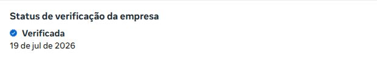
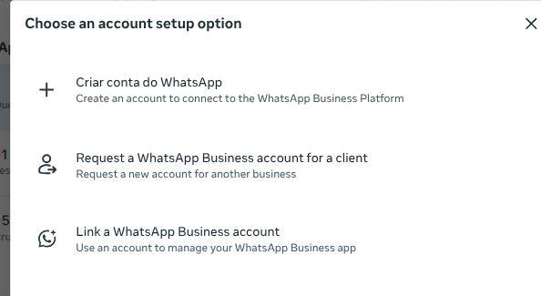
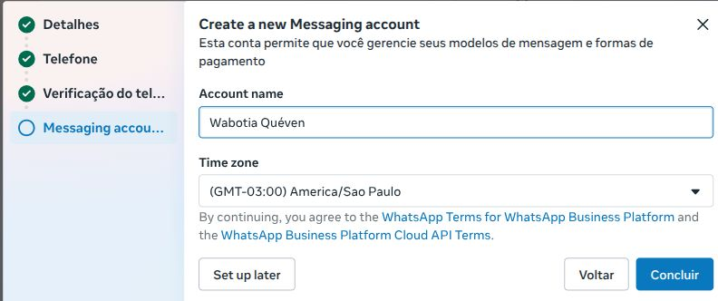
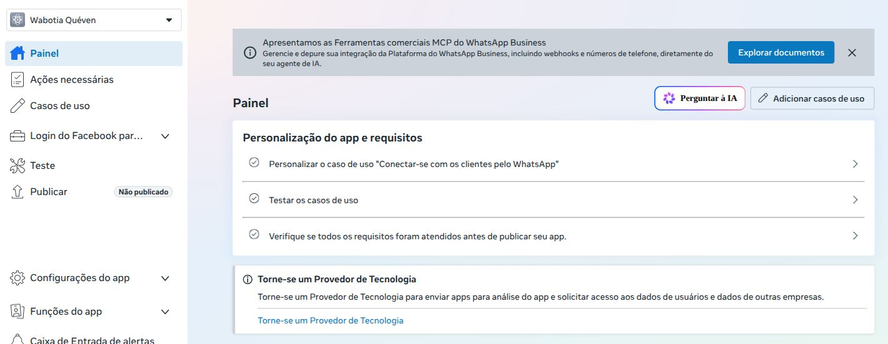
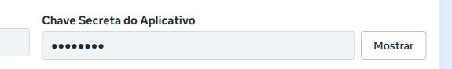
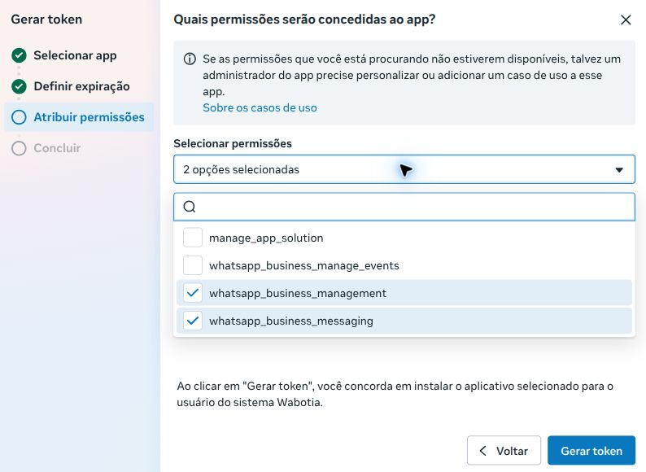
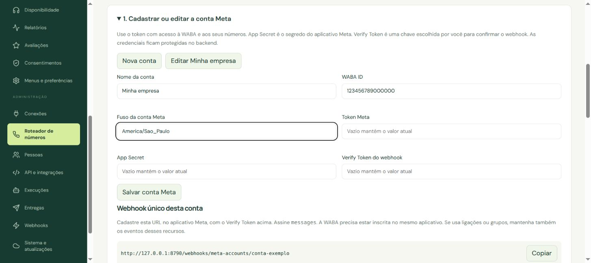
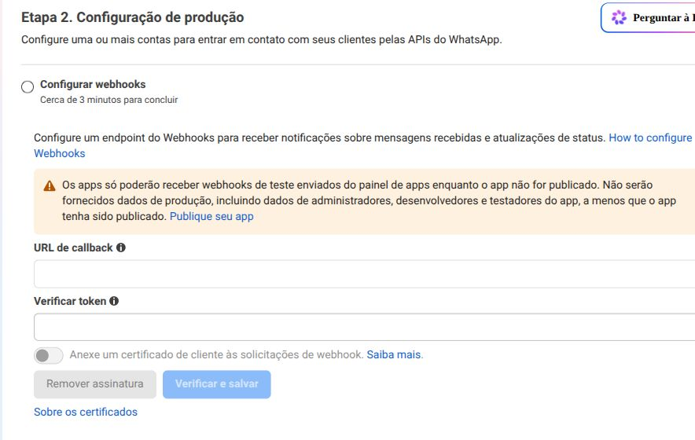

# Do chip à API oficial do WhatsApp

Guia para quem vai cadastrar **um número novo** na Meta e conectá-lo à sua instalação Wabotia. Referência de telas: 06/11/2026. A Meta libera mudanças de interface por conta; alguns botões aparecem em inglês.

Este caminho usa **Meta direto**. O WhatsApp é hospedado pela Meta; você não precisa instalar WhatsApp no Hermes, ler QR Code nem manter um celular conectado ao WhatsApp Web. O número continua sendo contratado e mantido com a operadora. O Hermes só executa os bots quando acionado pelo Wabotia.

## 1. O que preparar antes de abrir as telas

| Item | O que a pessoa responsável precisa ter |
|---|---|
| Acesso à Meta | Conta pessoal legítima do administrador ou conta Meta gerenciada, acesso ao e-mail e aos desafios de segurança. Ative a autenticação de dois fatores. Não compartilhe a senha entre funcionários. |
| Empresa | Nome comercial e razão social corretos, endereço, telefone, site e e-mail de contato. Para uma empresa brasileira, deixe CNPJ e documentos oficiais disponíveis caso a Meta os solicite. Use dados coerentes com os documentos. |
| Presença na internet | Site acessível, identificação da empresa, contato e política de privacidade que explique o uso dos dados. O nome público do WhatsApp deve ter relação verificável com a empresa. |
| Portfólio empresarial | O espaço da empresa no Meta Business Suite. O administrador precisa de controle suficiente para criar e atribuir os ativos. |
| Número próprio | Chip/eSIM ou linha sob controle da empresa, com DDI e DDD, capaz de receber SMS ou ligação. Não use um telefone de terceiro ou um número apenas fictício. |
| Wabotia instalado | URL HTTPS da **sua instalação**, administrador criado e perfil de atendimento. Use a versão atual disponível em Sistema e atualizações. |
| Cobrança | Responsável por revisar as tarifas e cadastrar a forma de pagamento solicitada pela Meta para uso pago. A cobrança da Meta é separada da Cloudflare e da operadora. |

**Número novo:** para este roteiro, não cadastre antes o chip no aplicativo WhatsApp do celular. Você receberá o código no aplicativo de SMS ou por chamada telefônica normal.

**Número que já usa WhatsApp:** não apague a conta para experimentar. O cadastro direto, a migração de outro provedor e a coexistência com WhatsApp Business são processos diferentes. A coexistência depende de um fluxo compatível de Cadastro Incorporado; não é uma opção automática deste roteiro. Faça uma avaliação e preserve os dados antes de migrar.

## 2. Quatro coisas diferentes, apesar dos nomes parecidos

| Nome na tela | Para que serve |
|---|---|
| Portfólio empresarial | Agrupa pessoas, permissões e ativos da empresa. Seu ID não é o WABA ID. |
| Conta do WhatsApp / WhatsApp account | Representa o perfil e o telefone que o cliente vê. A interface nova também usa a sigla WAAC. |
| Conta de mensagens / Messaging account | Organiza modelos e cobrança. Na interface nova, a configuração da API mostra a identificação dessa conta; nas telas antigas, aparece como WhatsApp Business Account ou WABA. |
| Aplicativo Meta | É o cadastro da integração que recebe permissões, tem um App Secret e configura o webhook. Não é um aplicativo para instalar no celular. |

**Não escolha um ID pelo tamanho ou pelo nome da empresa.** Copie o ID da conta exibido na **Configuração da API** do aplicativo ligado ao telefone. Confira a associação e a lista de números antes de preencher o campo WABA ID do Wabotia. O Phone Number ID é outro identificador, específico do telefone; não é o número com DDI/DDD.

## 3. Prepare e confira a empresa

1. Abra [Meta Business Suite](https://business.facebook.com/), selecione o portfólio correto e entre em **Configurações**.
2. Em **Informações da empresa**, confira nome, razão social, endereço, site e contato. Corrija divergências com os documentos antes de solicitar análise.
3. Procure **Status de verificação da empresa**. Se já aparecer **Verificada**, não crie outra empresa para repetir a verificação.
4. Se a Meta solicitar verificação, abra **Central de Segurança** e siga o processo disponível. Ela pode consultar cadastros públicos, pedir documentos oficiais e confirmar seu vínculo com a empresa por e-mail, telefone ou domínio. Envie somente o que a própria tela solicitar, pela Meta.
5. Acompanhe o resultado e eventuais pedidos de correção. Criar o portfólio, verificar a empresa e aprovar o nome de exibição do telefone são etapas distintas.

A verificação empresarial não é o selo pago Meta Verified. Também não é a **verificação de acesso como Provedor de Tecnologia**, usada para integrar ativos de outras empresas. Usar seus próprios números e oferecer uma plataforma para conectar contas de clientes são cenários diferentes. A Meta pode liberar testes antes da verificação e aplicar restrições de produção ou escala; os limites efetivos são os mostrados na sua conta.

## 4. Cadastre o perfil e o telefone

1. Em **Configurações → Contas → Contas do WhatsApp**, clique **Adicionar**.
2. Escolha **Criar conta do WhatsApp**. Para este roteiro, não escolha a opção de vincular o aplicativo WhatsApp Business já existente.
3. Informe o **Nome de exibição do WhatsApp Business**. Use o nome comercial reconhecido pelo cliente, sem promessas de aprovação, slogans ou um nome sem relação com a empresa.
4. Selecione a categoria correspondente à atividade real. Confira a foto e os campos opcionais, se desejar.
5. Leia os termos apresentados. O responsável pela empresa deve concordar antes de continuar.

6. Em **Escolha o número que deseja usar**, marque **Adicionar um novo número**. A opção “Usar somente um nome de exibição” não é o cadastro de um chip próprio descrito neste guia.
7. Selecione **BR +55** e digite **DDD + número**, sem repetir o +55. Exemplo de formato: para +55 (11) 99999-0000, o campo recebe `11999990000`. Este exemplo é fictício.
8. Escolha **SMS** ou **Ligação telefônica** e clique **Continuar**. Em linha fixa, prefira ligação e confirme que não existe uma URA impedindo a chamada.
9. Digite na própria Meta o código de seis dígitos recebido. Esse código é temporário; não é o token da API nem o PIN da verificação em duas etapas.
10. Se não chegar, confira país, DDD, sinal e bloqueios de SMS/ligações internacionais. Espere o prazo mostrado antes de reenviar ou trocar o método. Não repita pedidos rapidamente.

## 5. Conclua a conta de mensagens

1. Depois de confirmar o telefone, a interface pode mostrar **Create a new Messaging account**.
2. Em **Account name**, use um nome reconhecível, como **Atendimento da minha empresa**. Em **Time zone**, confira **(GMT-03:00) America/Sao Paulo** para operações nesse fuso.
3. Leia e aceite os termos dessa etapa quando concordar; clique **Concluir**.
4. Espere a confirmação **Conta do WhatsApp adicionada**. A Meta ainda pode analisar a conformidade da conta e o nome de exibição.

Se sua empresa já tem a conta de mensagens correta, use o fluxo de adicionar número nela pelo WhatsApp Manager ou pela Configuração da API. **Não crie uma conta de mensagens nova para cada telefone de um mesmo grupo.** O roteador exige que os números pertençam à mesma conta acessível pela API e respeita o limite concedido pela Meta, até o máximo de 20 suportado pelo Wabotia.

## 6. Crie o aplicativo da integração

1. Abra [Meta for Developers → Meus apps](https://developers.facebook.com/apps/). Se for o primeiro acesso, conclua o cadastro de desenvolvedor e as verificações solicitadas pela Meta.
2. Clique **Criar aplicativo**. Informe um nome, como **Wabotia Minha Empresa**, e um e-mail de contato que você acompanha.
3. Em **Casos de uso**, selecione **Conectar-se com clientes pelo WhatsApp**. Não selecione Login do Facebook ou anúncios como substitutos.
4. Em **Empresa**, marque o portfólio da sua empresa. Evite criar outro portfólio por engano.
5. Confira **Requisitos** e **Visão geral**. Aceite os termos somente se concordar e clique **Criar aplicativo**. Se a Meta pedir sua senha ou uma verificação de segurança, conclua pessoalmente.
6. Confira se abriu o **painel do aplicativo** em Meus apps. Seu endereço terá `developers.facebook.com/apps/ID_DO_APP/`. A conta de mensagens no Business Suite é outra tela. Se a confirmação de senha voltar à revisão, confira Meus apps antes de tentar novamente; não cadastre o telefone outra vez.
7. No painel, clique **Personalizar o caso de uso "Conectar-se com os clientes pelo WhatsApp"**. Na interface atual, siga **Configuração básica → Etapa 2. Configuração da produção** e expanda **Registre seu número de telefone do WhatsApp**. Confira a conta, seu **Messaging Account ID** e a **Identificação do número de telefone**. Um telefone já cadastrado pode aparecer automaticamente; não o adicione de novo.
8. Na interface antiga, o caminho pode ser **Personalizar → Conectar no WhatsApp → Início rápido → Começar a usar a API / Configuração da API**. Confira o telefone real no campo **De**. Um **Test Number** fornecido pela Meta não é o chip que você acabou de cadastrar.

Um aplicativo existente pode ser reutilizado se você controla suas configurações e elas são compatíveis. Alterar seu webhook pode afetar outro sistema. Para um atendimento independente, um aplicativo próprio facilita separar as configurações.

## 7. Saiba o que copiar e o que guardar

| Dado | Quem fornece | Onde usar no Wabotia |
|---|---|---|
| ID da conta de mensagens / WABA ID | **Messaging Account ID** na Configuração de produção do aplicativo, ou WABA ID na Configuração da API antiga | **Roteador de números → WABA ID**. Não é o ID do portfólio ou do app. |
| Phone Number ID | Meta, junto do telefone real na Configuração da API | A busca de números do roteador preenche a associação; na configuração individual, é o ID do telefone. |
| Token Meta de produção | Usuário do sistema com acesso ao aplicativo e à conta de mensagens | Campo protegido **Token Meta**. Permite operar a API conforme as permissões concedidas. |
| App Secret | Configurações do aplicativo Meta → Básico → Chave secreta do aplicativo | Campo protegido **App Secret**. Confere se os eventos recebidos vieram da Meta. |
| Verify Token | Você escolhe uma senha aleatória própria para verificar o webhook | Campo protegido **Verify Token** e o campo correspondente na Meta, com exatamente o mesmo valor. |
| PIN de seis dígitos | Você define para registrar/proteger o número na Cloud API | Etapa de registro do telefone; guarde em local privado. Não é o código SMS. |

O token temporário do botão **Gerar token de acesso** da Configuração da API serve para testes e expira rapidamente. Não o trate como a credencial definitiva de produção.

Guarde segredos em um gerenciador de senhas ou arquivo privado protegido. Pare a gravação da tela ao revelar, gerar ou copiar tokens. Não publique segredos no GitHub, no PDF, em capturas ou em chamados de suporte. O Wabotia mantém as credenciais dos canais no backend, criptografadas pela MASTER_KEY da instalação.

## 8. Gere o token de produção

1. Volte ao **Meta Business Suite → Configurações → Usuários → Usuários do sistema**.
2. Crie um usuário do sistema específico para a integração, como **Employee**. Um nome simples como **Wabotia** foi aceito no cadastro de referência. Um usuário do sistema representa o software; não é uma conta de atendente.
3. Em **Atribuir ativos → Apps**, selecione apenas o aplicativo da integração e **Gerenciar app**. Em **Contas de mensagens → Contas vinculadas**, selecione apenas a conta do atendimento. Na interface conferida, as permissões parciais cobrem modelos; **Tudo** inclui envio, configurações, atribuição de usuários e visualização de informações de pagamento da conta. O administrador deve avaliar e autorizar esse alcance. Não selecione os demais ativos da empresa. Clique **Atribuir ativos** e confira o resultado.
4. Selecione **Gerar token**, escolha o aplicativo correto e a validade. **60 dias** é a opção recomendada pela Meta: registre a data de vencimento e planeje a substituição antes dela. A opção **Nunca**, se oferecida, só deve ser escolhida por decisão explícita do administrador sobre acesso sem prazo; ela ainda pode ser revogada.
5. Autorize **whatsapp_business_management** para consultar números e modelos, e **whatsapp_business_messaging** para enviar e receber. O roteiro oficial também inclui **business_management** para gestão e consulta de ativos empresariais; use-o quando exigido pelo fluxo da sua conta, sem ampliar para ativos não relacionados.
6. Gere e copie o token uma vez para o local privado. Depois, preencha somente o campo protegido correspondente no Wabotia.

**Antes do vencimento:** no mesmo usuário do sistema, gere o novo token para o mesmo app e permissões. No Wabotia, edite a conta Meta e substitua apenas **Token Meta**; deixe App Secret e Verify Token vazios para preservar os valores salvos. Salve, busque os números e valide a conexão antes de revogar a credencial antiga. Não revogue indiscriminadamente todos os tokens de um usuário compartilhado.

Se aparecer “nenhuma permissão disponível”, confira se o app tem o caso de uso WhatsApp, se pertence à empresa correta e se os ativos foram atribuídos ao usuário do sistema. Não resolva esse erro concedendo permissões gerais indiscriminadamente.

## 9. Termine o registro na Cloud API

**Confirmar o SMS adiciona o telefone, mas pode não registrá-lo para enviar pela Cloud API.** Confira o estado do número na Configuração da API e no WhatsApp Manager. Se a Meta apresentar a etapa de registro, conclua-a antes de ativar o número no Wabotia.

Se não existir um botão de registro no seu fluxo, use a ferramenta oficial da Meta:

1. No Meta for Developers, abra **Ferramentas → Explorador da Graph API**. Pause a gravação.
2. Selecione o aplicativo da integração e coloque seu **token de produção** no campo de token. Não use App Secret, Verify Token ou senha de login nesse campo.
3. Escolha **POST** e o caminho `PHONE_NUMBER_ID/register`, substituindo `PHONE_NUMBER_ID` pelo ID do telefone real. Use uma versão da Graph API suportada pela sua conta.
4. Na área de parâmetros/corpo, adicione `messaging_product` com o valor `whatsapp` e `pin` com um PIN de seis dígitos escolhido pelo responsável. Guarde o PIN em local privado; não use um valor de exemplo nem o código SMS por conveniência.
5. Confira o telefone correspondente ao ID e envie uma vez. O resultado esperado é `success: true`. Confira novamente o telefone no WhatsApp Manager.

O registro envia o **Phone Number ID**, o token autorizado e o PIN para a Meta. Não cole esses segredos em uma ferramenta de terceiros. Se o telefone já estiver conectado e funcionando pela API, não repita o registro nem redefina seu PIN apenas para cumprir esta receita.

Antes de repetir um registro que ficou sem resposta, confira o estado do telefone. Não troque nem redefina o PIN para tentar corrigir um erro de token. Guarde o PIN e preserve o controle da linha com a operadora.

## 10. Coloque os dados no Wabotia

1. Abra a URL HTTPS da **sua instalação**, entre como administrador e escolha o perfil de atendimento. O site oficial de demonstração não é o seu painel de produção.
2. Abra **Roteador de números → Cadastrar ou editar a conta Meta**. Esse caminho também funciona para começar com **um único número**.
3. Preencha nome, **WABA ID/ID da conta usado pela API**, fuso da conta Meta, **Token Meta**, **App Secret** e **Verify Token**. Salve e espere a confirmação.
4. Copie **Webhook único desta conta**. Ele contém o domínio da sua instalação e termina em `/webhooks/meta-accounts/ID_DA_CONTA`.
5. Mantenha o cadastro de números pausado enquanto confere o webhook e o registro na Meta.

**Não misture duas configurações:** se usar o roteador, use o webhook da conta. Uma conexão Meta individual em **Conexões** tem outro caminho. Não cadastre o mesmo telefone duas vezes nem deixe outro sistema respondendo simultaneamente. Para adotar uma conexão existente no roteador, pause e reconcilie suas entregas primeiro.

## 11. Configure o webhook na Meta

1. No aplicativo Meta, abra **Personalizar o caso de uso WhatsApp → Configuração básica → Etapa 2. Configuração da produção → Configurar webhooks**. Nas telas antigas, procure **WhatsApp → Configuração → Webhook → Editar/Configurar**.
2. Em **URL de callback**, cole o endereço copiado do Wabotia. Ele deve usar HTTPS e estar acessível à Meta, sem uma página de login da Cloudflare Access na frente.
3. Em **Token de verificação**, coloque **o mesmo Verify Token** salvo no Wabotia. Não coloque o token Meta nem o App Secret nesse campo.
4. Clique **Verificar e salvar**. Espere a confirmação; só colar a URL não ativa a integração.
5. Em **Campos de webhook**, assine **messages**. Ele entrega mensagens e recibos. Ligações e grupos precisam também dos respectivos eventos, quando habilitados.
6. Confira se a **conta de mensagens está inscrita no aplicativo**. Na tela nova, expanda **Registre seu número de telefone do WhatsApp** e ligue **Assinar webhooks** na conta correta. A assinatura dos campos e o vínculo da conta são duas coisas diferentes; na API, o vínculo é conferido em `/{ID_DA_CONTA}/subscribed_apps`.

Se precisar conferir pela ferramenta oficial **Explorador da Graph API**, selecione o aplicativo e seu token correto. Use **GET** no caminho `ID_DA_CONTA/subscribed_apps` e procure o app esperado na resposta. Se ele não estiver inscrito e essa for a integração desejada, **POST** no mesmo caminho inscreve o aplicativo do token. Confirme com outro GET. Não remova inscrições de outros sistemas sem avaliar o uso.

O Wabotia confere o desafio do webhook com o Verify Token e confere a assinatura dos eventos com o App Secret. Use o App Secret do **mesmo aplicativo que envia os eventos**. A tela “Testar” da Meta usa eventos simulados e não substitui o recebimento por um telefone real.

## 12. Publique o aplicativo

A tela atual da Meta informa que **apps não publicados recebem somente webhooks de teste enviados pelo painel**, sem dados de produção, inclusive de administradores e testadores. Verificar a URL não substitui publicar o aplicativo.

1. No menu do aplicativo, abra **Publicar** e confira as pendências.
2. Preencha os dados e as URLs públicas solicitadas com informações reais da empresa. Quando exigidas, a política de privacidade e as instruções de exclusão de dados precisam descrever o atendimento e seu tratamento de dados, estar acessíveis e ter um responsável real. Não use uma URL inventada ou a política de outra empresa.
3. Conclua as verificações e análises exigidas para o uso escolhido. O fluxo para operar os próprios números é diferente do acesso aos ativos de clientes.
4. Publique quando todos os requisitos estiverem atendidos e confira o status **Publicado**. Volte ao webhook e ao número antes do teste real.

Publicar o aplicativo, aprovar o nome de exibição do telefone e verificar a empresa são etapas separadas.

## 13. Busque o telefone e confira a operação

1. No Wabotia, clique **Buscar números na Meta**. O telefone real deve aparecer com seu nome e Phone Number ID.
2. Selecione o telefone, dê um nome e informe as mensagens de atendimento já utilizadas no mês. Use zero somente se não houve uso.
3. Confirme fuso e consumo inicial, defina o teto local e clique **Adicionar ao roteador**. O cadastro entra pausado.
4. Confira no WhatsApp Manager: número registrado/conectado, nome de exibição e situação da conta, qualidade, limites e eventuais pendências de cobrança. Nem toda pendência é resolvida pelo Wabotia.
5. Quando estiver pronto para o teste, ative o número e o perfil. Use outro WhatsApp, sob seu controle, para iniciar uma conversa com esse telefone.
6. Confira a mensagem em **Conversas**, assuma o atendimento e responda. Confira a resposta no celular e o recibo em **Entregas**. O estado “na fila” não prova entrega.
7. Antes de usar com clientes, teste anexos, retomada após falha e o bot, se for usar Hermes. Para enviar modelo pago, use um modelo aprovado e autorize **cada envio**, com consentimento do destinatário.

Não inicie um teste pago apenas porque o número apareceu na lista. O cadastro do telefone não é uma autorização automática para cobrança ou envio a clientes.

## 14. Erros comuns, sem precisar adivinhar

| Situação | O que conferir primeiro |
|---|---|
| Código SMS não chegou | País/DDD, linha ativa, sinal, bloqueio de SMS internacional e prazo antes de reenviar. Tente voz quando a tela permitir. |
| Número já cadastrado no WhatsApp | Interrompa o roteiro de número novo e avalie migração/coexistência. Não apague a conta por tentativa. |
| Nome em análise ou rejeitado | Use nome ligado à empresa e confira as orientações da Meta. SMS confirmado não aprova automaticamente o nome. |
| Número verificado, mas não envia | Confira registro Cloud API, token, ativos atribuídos, permissão de envio, situação da conta e cobrança. |
| Token inválido/expirado | Gere o token correto do usuário do sistema; não use o temporário como definitivo. Substitua no campo protegido do Wabotia. |
| Nenhum número na busca | Confira a conta selecionada no app, o ID copiado e o acesso do usuário do sistema. ID do portfólio, do app e do telefone não substituem o ID da conta. |
| Webhook não verifica | Conta salva primeiro no Wabotia, URL exata, HTTPS público e Verify Token idêntico. |
| Verificou, mas não recebe | Aplicativo publicado, campo messages assinado, conta inscrita no aplicativo, App Secret correto, número cadastrado/ativo e perfil correto. |
| Resposta fora da janela | O cliente precisa iniciar contato para abrir a janela de atendimento; fora dela, use o modelo autorizado compatível. |
| Dois sistemas respondem | Pause o consumidor antigo e reconcilie suas filas. Cada número deve ter um modo ativo no Wabotia. |

## Fontes oficiais

- [Introdução à Cloud API, com fluxo atual de criação de app e tokens](https://developers.facebook.com/documentation/business-messaging/whatsapp/get-started/).
- [Números de telefone: requisitos, cadastro e diferença entre verificação e registro](https://developers.facebook.com/documentation/business-messaging/whatsapp/business-phone-numbers/phone-numbers).
- [Registro de telefone na Cloud API](https://developers.facebook.com/documentation/business-messaging/whatsapp/business-phone-numbers/registration).
- [Meta Business Suite](https://business.facebook.com/) e [Meus apps](https://developers.facebook.com/apps/).
- [Termos WhatsApp Business Platform](https://www.whatsapp.com/legal/WhatsApp-Terms-for-WhatsApp-Business-Platform/), [termos Meta para a plataforma](https://www.facebook.com/legal/Meta-Terms-for-WhatsApp-Business-Platform) e [termos de hospedagem Cloud API](https://www.facebook.com/legal/Meta-Hosting-Terms-Cloud-API).

As capturas reais foram recortadas para evitar exposição de dados privados. As telas Wabotia identificadas como referência usam dados fictícios. Uma captura de cadastro concluído não comprova envio/recebimento ou aprovação definitiva da Meta.
