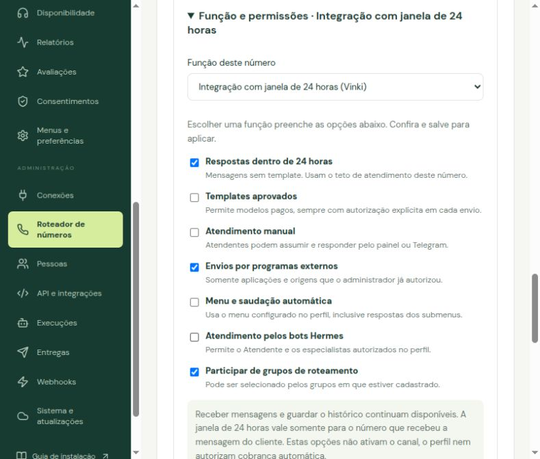

# Roteador de telefones WhatsApp

O roteador permite importar telefones WhatsApp conectados à mesma integração Zernio, receber pelo mesmo webhook e escolher o remetente pela API: um telefone específico ou um grupo autorizado. O Wabotia não impõe um limite fixo de linhas. QR e transporte Hermes continuam separados.

## Franquia, janela e cobrança

Consulte a [cobrança de WhatsApp pela Zernio](https://docs.zernio.com/platforms/whatsapp/pricing) e configure os limites locais conforme seu plano. Templates e serviços podem ter cobranças distintas. O contador local não substitui as faturas.

- **Atendimento:** o cliente precisa ter enviado mensagem para aquele mesmo telefone nas últimas 24 horas. Ter saldo em outro telefone não transfere essa janela.
- **Remetente fixo:** depois da primeira escolha, o atendimento permanece no telefone original. Se **Bloquear excedente da cota local** estiver ligada, o fim do saldo bloqueia novas mensagens de serviço com `quota_exhausted`. Caso contrário, o atendimento pode continuar com serviço pago. Pausa, falha ou perda de permissão não provocam envio por outro remetente.
- **Novos clientes:** divulgue o link público do grupo. Ele alterna os telefones ativos desde a primeira entrada, priorizando os que ainda têm cota local; o cliente inicia a conversa. Linhas sem saldo que bloqueiam excedente saem da seleção. As demais podem continuar com serviço pago. O link sozinho não envia nada nem reserva uma mensagem.
- **Modelos pagos:** cada pedido precisa de `allow_paid: true`, comprovação do consentimento e modelo aprovado. A aplicação, a origem e o grupo precisam autorizar pagos. Uma configuração geral não substitui a autorização por envio.
- **Notificações automáticas de telefones gerenciados:** não são convertidas em modelos pagos. Ao acabar a janela, falham com orientação para pedir nova mensagem ou usar o envio explícito de modelo.

A cota local configurada pode ser de 0 a 1.000. Em **Função e permissões → Bloquear excedente da cota local**, escolha se ela deve bloquear o excedente de serviço. A opção começa desligada nas linhas existentes. Selecionar e salvar o preset **Integração com janela de 24 horas (Vinki)** liga esse bloqueio e mantém templates desabilitados. Com excedente permitido, a 1.001ª mensagem pode continuar no mesmo telefone com cobrança, dentro da janela de 24 horas. Serviço pago não vira template e não depende de `allow_paid` ou `routing:paid`; essas autorizações continuam específicas para templates. A regra de janela vencida permanece: aguardar nova mensagem do cliente ou solicitar explicitamente um template aprovado.

Na API, a opção corresponde a `policy.service_overage: false`. Omitir esse campo em um cliente antigo preserva a opção já salva; linhas sem essa opção continuam permitindo excedente. A reserva e a conferência do saldo são feitas no mesmo comando de banco, incluindo envios simultâneos. A política é conferida novamente antes da entrega: reduzir a franquia ou ligar o bloqueio cancela mensagens pendentes que excedam o novo saldo, respeitando a ordem das reservas. Mensagens já enviadas ou sem confirmação continuam contando; não são repetidas em outro telefone. A permissão de templates continua separada: para uma linha restrita ao serviço dentro da franquia, mantenha também `templates: false`.

Cada pedido de serviço também pode enviar `free_only: true`. Essa restrição permanece na mensagem enfileirada mesmo que a linha permita excedentes ou sua configuração mude depois. Aplicações conectadas pelo pareamento **Vinki** sempre usam essa restrição por regra do servidor, inclusive se omitirem o campo, enviarem `false` ou usarem o envio direto de conversa. Templates pagos são recusados para esses pedidos e para Vinki pareado. Outras aplicações antigas mantêm o comportamento anterior. O contador continua sendo uma estimativa local, sem garantia de fatura zero.

## 1. Prepare a integração Zernio

Siga o [guia WhatsApp pela Zernio](ZERNIO-WHATSAPP.md). Em **Integração Zernio**, cadastre nome, API key, fuso e segredo de assinatura do webhook. Depois de salvar, use **Encontrar ID na Zernio** e confirme a integração pelo nome. Em **Telefones**, busque e importe somente os telefones já cadastrados na Zernio. Campos de credencial vazios na edição mantêm os valores atuais; o cadastro do telefone no provedor é gerenciado no painel Zernio.

## 2. Configure o webhook na Zernio

Copie a URL exibida, terminada em /webhooks/zernio-accounts/ID_DA_CONTA. Cadastre-a nos webhooks da Zernio, com o mesmo segredo de assinatura, e habilite os eventos de recebimento, envio, entrega, leitura e falha. A assinatura é verificada pelo Wabotia.

## 3. Adicione os telefones e o consumo inicial

1. Clique **Buscar telefones na Zernio**. A busca apenas consulta a integração.
2. Escolha um telefone encontrado e dê um nome fácil de reconhecer.
3. Confira no provedor quantas mensagens de atendimento esse telefone já usou no mês. Informe em **Mensagens de atendimento já usadas neste mês**. Zero somente se realmente não houve uso.
4. Defina o **Limite local mensal de serviço**, no máximo 1.000. Ele limita os envios de serviço quando **Bloquear excedente da cota local** estiver ligada; com a opção desligada, pode haver excedente pago. Confirme o uso inicial e o fuso, depois clique **Adicionar telefone ao Wabotia**. Repita para os telefones habilitados na sua integração Zernio.
5. Os telefones entram pausados. Confira o webhook e clique **Ativar** na lista de uso. A área de atendimento também precisa estar pronta para o atendimento normal.

Para telefones de uma integração Meta anterior, resolva operações em andamento ou sem confirmação e exclua a linha antiga antes de conectar pela Zernio. O histórico anterior é preservado separado da nova conexão. Não reinicie o contador para obter saldo artificial.

**Como ler o painel:** uso estimado = histórico inicial do mês + entregas de atendimento + reservas de envios ainda não confirmados. Um anexo é uma mensagem; texto separado é outra. Envios humanos, bots e API no telefone gerenciado compartilham o mesmo contador. Falha definitiva e cancelamento antes do envio liberam a reserva. `unknown` mantém a reserva e exige conferência. Na mudança de mês, o histórico inicial deixa de contar; mensagens ainda sem confirmação continuam reservadas.

Recibos confirmam entrega e leitura quando disponíveis. Informações de cobrança podem não estar presentes nos eventos da Zernio; nesse caso o estado continua sem confirmação de preço. Recibos repetidos não somam novamente. O horário da entrega, no fuso da integração, define o mês confirmado. Envios feitos fora do Wabotia só são observados se seus recibos chegarem a esse webhook; podem consumir saldo antes de o Wabotia saber. **O contador é uma estimativa local e não garante uma fatura sem cobrança, mesmo com Bloquear excedente da cota local ligada.** A opção limita os envios pelo contador conservador do Wabotia; a cobrança real deve ser conferida nas faturas da Zernio e da Meta. Confira seu painel do provedor, sobretudo após interrupções ou se outro sistema usar o telefone. O painel não estima preço em reais.

## 3.1. Defina o que cada telefone pode fazer

Na etapa **Telefones**, cada cartão em **Seus telefones e consumo** tem **Função e permissões**:

1. Abra **Função e permissões** no telefone desejado.
2. Escolha **Atendimento oficial** para seu telefone de contato permanente, ou **Integração com janela de 24 horas (Vinki)** para uma linha utilizada por sistemas externos.
3. Confira as opções individuais. Alterá-las muda a função para **Personalizado**.
4. Clique **Salvar função e permissões** e aguarde a confirmação. Salvar não ativa o canal nem a automação da área de atendimento.

| Opção | Atendimento oficial | Integração de 24 horas |
|---|---|---|
| Respostas sem template dentro de 24 horas | Sim | Sim |
| Bloquear excedente da cota local | Não | Sim |
| Templates aprovados, autorizados por envio | Sim | Bloqueados |
| Atendimento manual no painel/Telegram | Sim | Bloqueado por padrão |
| Envios de aplicações já autorizadas | Sim | Sim |
| Menu e saudação automática | Sim | Desligados |
| Bots Hermes autorizados na área de atendimento | Sim | Desligados |
| Participar dos grupos em que estiver cadastrado | Não por padrão | Sim |

As opções podem ser combinadas. Por exemplo, para uma linha que só envia templates, desmarque **Respostas dentro de 24 horas** e mantenha **Templates aprovados**, além da origem humana/API correspondente. Para permitir atendimento manual na linha de integração, marque essa opção. Receber mensagens e consultar o histórico continuam disponíveis, inclusive quando nenhuma resposta está permitida.



Menu e bots utilizam a configuração da área de atendimento e só respondem quando a automação dessa área de atendimento está ativa. Desligar ambos impede saudações, menus, respostas de bots e avisos automáticos ao cliente. Solicitações de revogação de consentimento continuam registradas. Os programas recebem os eventos normalmente e só enviam dentro das permissões concedidas. Notas internas e acompanhamento continuam disponíveis.

Uma permissão de grupo ou de aplicação nunca libera o que o telefone bloqueou. A verificação ocorre antes de entrar na fila e novamente antes do envio. Desligar uma opção bloqueia entregas ainda pendentes; não apaga mensagens já enviadas nem transfere conversas. Contadores e consentimentos são preservados. Ao atualizar, telefones existentes mantêm suas opções anteriores até o administrador escolher e salvar uma função.

**Contadores:** mensagens de serviço gratuitas e pagas entram no uso estimado; templates entregues aparecem em outro campo. O total de mensagens pagas inclui todas as categorias informadas pela Meta. Não confunda 1.000 mensagens com 1.000 clientes: confirmação, chamada da senha e lembrete podem consumir três mensagens de serviço.

**Exemplos além do Vinki:** retirada de pedidos em restaurantes/lojas, check-in e chamada de recepção, estacionamento/valet e solicitações de documentos no ERP. O cliente abre o link e envia a mensagem; as respostas retornam pelo mesmo telefone durante a janela. Para documentos e dados pessoais, valide a identidade e as permissões no sistema de origem antes de entregar. Lembretes para dias seguintes precisam de template autorizado ou de nova mensagem do cliente.

## 4. Crie um grupo

Antes de criar o grupo, configure a função de cada telefone conforme o passo abaixo.

Em **Distribuição → Criar grupo de roteamento**, informe um nome e selecione membros da mesma integração. O grupo usa **rodízio com prioridade à cota local**: alterna entre os telefones que ainda têm franquia, mesmo que seus consumos sejam diferentes. Quando todos a consumirem, continua apenas com os telefones ativos que permitem excedente. Se todos bloquearem excedente, retorna `quota_exhausted`. Grupos antigos configurados como menor consumo ou aleatório também passam a seguir essa regra.

Entradas simultâneas são serializadas por área de atendimento. Respostas de conversas já vinculadas mantêm seu telefone e não avançam a vez de novos atendimentos. Por exemplo: com três linhas disponíveis, as seis próximas entradas serão A, B, C, A, B, C; a conversa de A continua vinculada a A mesmo se sua franquia terminar. Com bloqueio de excedente, novas respostas aguardam saldo; não são transferidas automaticamente para B ou C.

Ative o grupo. Marque **Criar link público** para divulgar uma entrada única. Se desejar modelos pagos, marque a opção específica; ela só habilita pedidos individualmente autorizados. Salve e copie o ID para integrações. Um telefone pode estar em vários grupos; seu consumo continua único.

## 5. Autorize cada programa externo

Crie a aplicação e sua chave em **API e integrações**, concedendo acesso à área de atendimento. Depois, em **Integração Zernio → Acesso dos sistemas**, selecione a aplicação e marque seus telefones diretos ou grupos. A seleção de um grupo autoriza os membros atuais e futuros desse grupo. Para usar `number_id` diretamente, dê a permissão individual.

Salvar adiciona `routing:read`, `routing:send`, `conversations:read` e `conversations:write`. A opção de modelos pagos adiciona `routing:paid` e habilita pagos nas origens selecionadas. Remover essa opção revoga a autorização paga dessas origens; o escopo pode continuar necessário para outras origens autorizadas. Para anexos, conceda também `media:read/write`. Para acompanhar eventos, use `events:read`/`webhooks:manage` conforme o uso.

Aplicações não recebem chaves Zernio nem segredos. O autor é definido pela chave Bearer. As permissões são conferidas na fila e novamente antes de enviar; revogar a origem cancela uma entrega ainda pendente.

## 6. Envie pela API

Base: `/api/v1/profiles/{area_id}`, substituindo `{area_id}` pelo ID da área de atendimento. O caminho técnico da API permanece o mesmo. Todas as escritas exigem `Idempotency-Key`. Guarde a chave da intenção e reutilize-a com conteúdo idêntico após falha de rede. Não gere uma nova automaticamente.

| Método e caminho | Resultado |
|---|---|
| `GET /router` | Telefones, grupos autorizados, franquia, excedente estimado e reservas |
| `POST /router/messages` | `202`, `delivery_id`, conversa e remetente escolhido |
| `GET /router/messages/{delivery_id}` | Fila, aceitação e recibo do provedor quando disponível |
| `POST /router/messages/{delivery_id}/cancel` | Cancela somente `pending`, pelo autor ou administrador |

Escolha **um** `number_id` ou `pool_id` retornado pela API, nunca ambos. `external_id` é um identificador estável do cliente/atendimento no integrador, separado por aplicação. Reutilize-o para esse destinatário e origem, inclusive ao abrir novos protocolos; não troque esse ID para tentar outro remetente. `conversation_id` é opcional para vincular uma conversa autorizada. `to` é obrigatório no primeiro pedido; use DDI/DDD e só dígitos.

Para avisos com prazo, informe `expires_at` como inteiro em milissegundos Unix: deve estar no futuro e no máximo 24 horas adiante. O prazo fica salvo com a mensagem e o envio é cancelado se vencer antes da entrega ao canal. Omitir mantém o comportamento anterior. A resposta inicial e a consulta do envio mostram `free_only` efetivo e `expires_at` (ou `null`); o payload interno não é exposto. `billing.service_overage_allowed` reflete a restrição do pedido, enquanto `usage.service_overage_allowed` descreve a política geral da linha.

Exemplo de atendimento, salve em `mensagem.json`:

```json
{"pool_id":"ID_GRUPO","to":"5511999991111","external_id":"cliente-123","text":"Olá! Como podemos ajudar?"}
```

O cliente precisa ter falado com esse telefone nas últimas 24 horas. A resposta informa `billing.mode: service_allowance` ou `service_paid` como estimativa, e `usage.free_remaining`/`paid_service_estimated`; a confirmação final vem da Meta. `usage.service_overage_allowed: false` indica bloqueio de excedente: ao atingir o saldo, o pedido retorna `quota_exhausted`. Os campos antigos `usage.limit` e `remaining` continuam representando a franquia. Para escolher um telefone, substitua `pool_id` por `number_id`. O envio assume a conversa na identidade da aplicação; outro responsável precisa transferir/liberar antes.

```sh
curl --fail-with-body "$WABOTIA_URL/api/v1/profiles/$WABOTIA_PROFILE/router/messages" \
  -H "Authorization: Bearer $WABOTIA_KEY" -H 'Content-Type: application/json' \
  -H "Idempotency-Key: $WABOTIA_REQUEST_ID" --data-binary @mensagem.json
```

Modelo pago, use um modelo **realmente aprovado** e consentimento da mesma categoria:

```json
{
  "pool_id": "ID_GRUPO", "to": "5511999992222", "external_id": "cliente-456",
  "allow_paid": true,
  "consent": {"granted": true, "category": "utility", "reference": "Aceite no pedido 456"},
  "template": {"name": "pedido_atualizado", "language": "pt_BR", "components": [
    {"type": "body", "parameters": [{"type": "text", "text": "456"}]}
  ]}
}
```

Suporta texto posicional/nomeado, cabeçalho de imagem/vídeo/documento com `media_id` privado e botões URL/OTP, resposta rápida e copiar código. Não use URLs públicas para anexos privados. Exemplo de cabeçalho: `{"type":"header","parameters":[{"type":"image","media_id":"ID_ARQUIVO_WABOTIA"}]}`. Carrosséis e outros componentes não implementados são recusados. A Meta faz a validação final e pode rejeitar um modelo alterado/suspenso depois da consulta.

JavaScript e Python executáveis, alternativas ao cURL:

```sh
node examples/router-message.mjs mensagem.json
python3 examples/router-message.py mensagem.json
# Para um pedido de modelo pago: JSON com allow_paid:true E confirmação no comando.
node examples/router-message.mjs modelo-pago.json --allow-paid
```

Configure `WABOTIA_URL`, `WABOTIA_KEY`, `WABOTIA_PROFILE` e `WABOTIA_REQUEST_ID` no servidor do seu sistema. **Esses exemplos enviam de verdade quando apontados para sua instalação.** Escolha uma alternativa; não execute todas para o mesmo pedido. Os testes do repositório usam servidor fictício local.

`pending` significa na fila; `sent` significa aceito pelo canal, não prova de recebimento. `provider_status: delivered/read` confirma o recibo. `billable: null` significa que a Meta ainda não informou a cobrança. Estado `unknown` não autoriza tentativa automática. Conferir uma nova tentativa de modelo em Entregas exige nova autorização explícita de cobrança.

Erros relevantes: `source_not_allowed` (origem), `paid_disabled` (grupo), `consent_revoked` (aceite retirado), `sender_pinned` (tentativa de trocar origem), `sender_unavailable` (remetente vinculado indisponível), `quota_exhausted` (franquia consumida ou reservada com bloqueio de excedente) e `no_eligible_sender` (sem telefone com janela/condições). Atendimento nunca faz fallback para modelo pago. Uma conversa criada por modelo pago não abre 24 horas até o cliente responder de verdade.

Acompanhe `message.sent`, `message.updated` e `conversation.updated` nos eventos/webhooks já existentes, correlacionando conversa e `source_key` quando disponível. Para entrega individual, use o GET acima. OpenAPI 3.1 e documentação interativa: `/api/openapi.json` e `/api-docs`.

## 7. Homologue antes de atender clientes

Use telefones/destinatários autorizados. Confira recebimento em cada telefone; envio individual; escolha de grupo; remetente fixo; janela vencida; negativa de pago sem autorização; um modelo autorizado; status e contagem Meta. Repita a mesma chave para verificar ausência de duplicação. Pause um telefone e confira que ele sai do rodízio. Simule o fim da franquia nos dois modos: com excedente permitido, conversas continuam na linha original; com **Bloquear excedente da cota local**, respostas são bloqueadas e novas entradas procuram linhas ainda com saldo. Quando todas bloquearem excedente e estiverem sem saldo, confira `quota_exhausted`. Não aumente artificialmente a franquia. Compare o contador com a Meta no fuso correto. Testes simulados aprovados não substituem esta homologação real.
