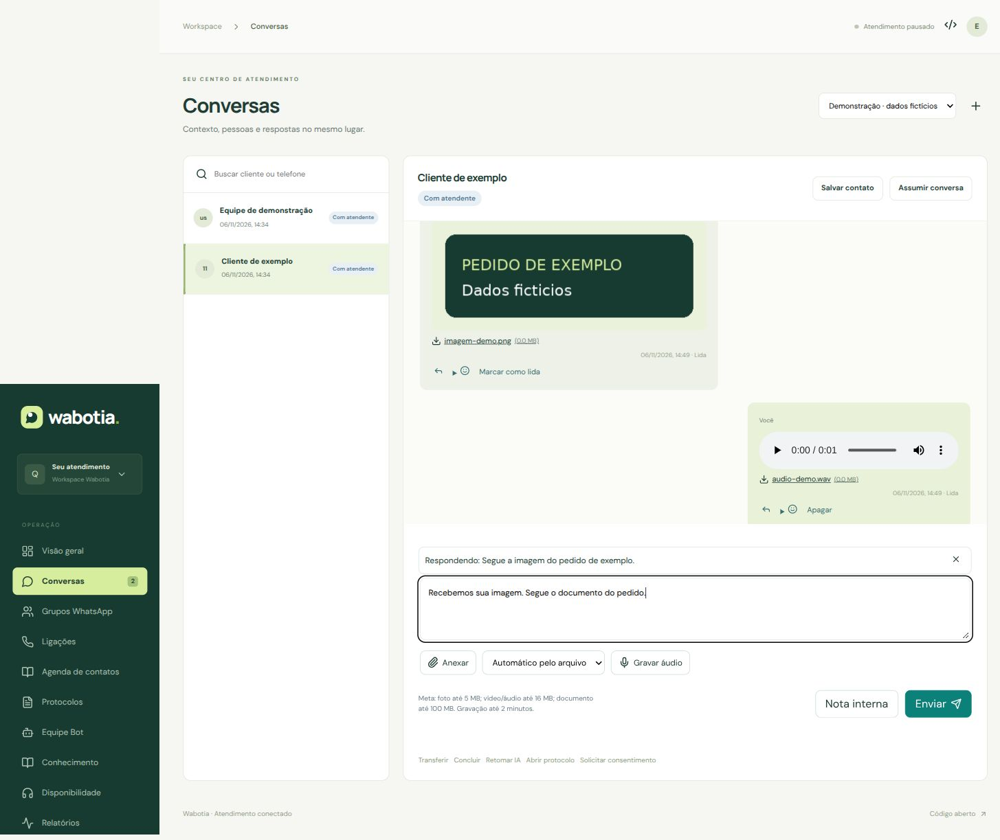
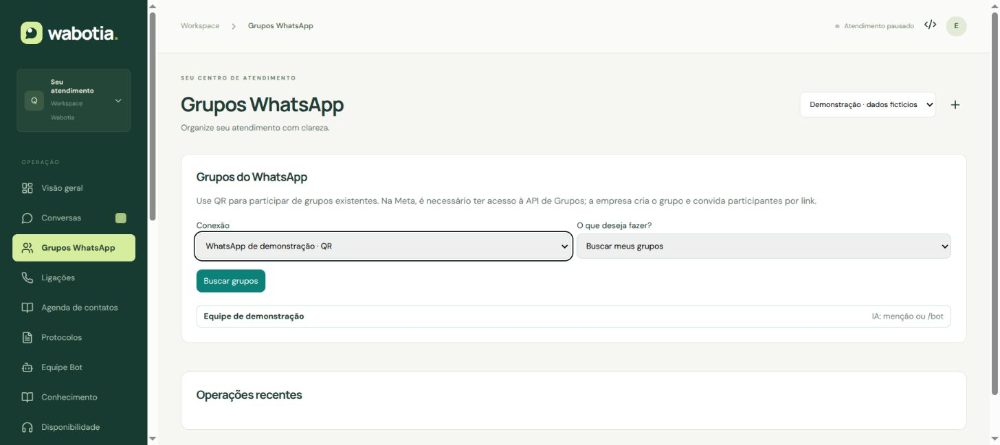

# WhatsApp: mídias, grupos e ligações

Disponível a partir de 0.5.0. As telas deste guia usam dados fictícios. Os testes automatizados usam provedores simulados; o teste com seu número real é a última etapa.

## Primeiro, atualize os dois lados

1. Faça backup e abra **Sistema e atualizações → Verificar atualização → Atualizar Wabotia**. Espere a confirmação e reabra o painel. A migração adiciona tabelas e campos, preservando conversas, agenda e credenciais.
2. **Zernio:** conecte o número e configure o webhook conforme o [guia Zernio](ZERNIO-WHATSAPP.md). Linhas Meta anteriores são pausadas e exigem reconexão pela Zernio.
3. **QR direto:** atualize também o processo externo. O botão do painel não atualiza o computador/VPS. Pause a conexão, confira Entregas, pare o conector, faça backup e siga [atualização QR](../connectors/qr/README.md#atualizar-sem-perder-a-sessão).
4. **WhatsApp pelo Hermes:** atualize o transporte e a extensão compatível com o gateway parado. Preserve perfis, bots e diários; siga [o roteiro Hermes](../connectors/hermes/README.md#atualização-050).
5. Não ligue dois consumidores para o mesmo número. Depois da atualização, o conector informa os recursos que oferece. Conector antigo precisa ser atualizado antes de usar as funções novas.

## O que cada modo oferece

| Recurso | Zernio | QR direto | Pelo Hermes |
|---|---|---|---|
| Imagem, vídeo, áudio e documento | Sim | Sim | Conforme adaptador instalado |
| Voz gravada no painel | OGG/Opus | OGG/Opus | Conforme adaptador; QR Hermes pode converter áudio |
| Figurinha WebP | Não nesta integração | Sim | Meta Hermes |
| Responder citando e reagir | Sim em conversa individual | Sim | Citação/reação na Meta Hermes |
| Editar/apagar mensagem enviada | Não disponível na API Meta | Sim, sujeito às regras do WhatsApp | Só se anunciado pelo adaptador |
| Marcar como lida e recibos | Sim | Sim | Não presumido; depende do gateway |
| Localização e cartão de contato | Sim em conversa individual | Sim | Meta Hermes; localização conforme adaptador |
| Grupos existentes, convite e administração | Grupos empresariais elegíveis | Sim, conforme permissões do número | Entrega de mensagens; sem administração de grupos pelo painel |
| Ligação de voz pelo navegador | Não nesta integração | Não | Não |
| Videochamada | Não | Não | Não |

Isso não inclui Status, Comunidades, transmissões, enquetes, pagamentos nem todas as funções do aplicativo pessoal. A Meta pode recusar uma função conforme o número, país, permissões e regras atuais. O modo QR depende do Baileys e do processo externo permanecer ligado.

## Enviar e receber arquivos

1. Abra **Conversas** e selecione o atendimento. Clique **Assumir conversa**. Isso pausa a IA e invalida respostas antigas ainda em preparação.
2. Clique **Anexar**, escolha até dez arquivos e, se desejar, escreva a legenda. Use **Automático pelo arquivo** ou **Enviar como documento**. Cada anexo gera uma mensagem; áudio e figurinha recebem o texto em uma mensagem separada.
3. Clique **Enviar**. O painel mostra o nome do arquivo e a porcentagem de upload. Arquivos maiores são enviados em partes, sem expor o bucket R2.
4. **Na fila** significa que o Wabotia recebeu o pedido. **Enviada** significa confirmação do provedor. **Entregue**, **Lida** e **Ouvida** dependem dos recibos disponibilizados pelo canal e pelas configurações do destinatário.
5. Na mensagem recebida, reproduza vídeo/áudio no próprio painel ou clique no nome para baixar. O arquivo exige login/permissão; não há link público permanente.

**Voz:** clique **Gravar áudio**, permita o microfone no navegador, grave por até dois minutos, pare, ouça a prévia e envie. O gravador produz OGG/Opus no navegador. Pode descartar a gravação antes de enviar. A primeira permissão depende do navegador; use HTTPS.

**Citação e ações:** use a seta na mensagem para responder a ela. O ícone de rosto abre reações. Editar, apagar e marcar como lida aparecem somente quando o canal oferece a ação. Edição de texto tem limite de 15 minutos no Wabotia e ainda está sujeita à aceitação do WhatsApp. Apagar no canal não apaga o registro de auditoria do atendimento.

**Localização/contato:** escolha o tipo no seletor. A localização usa coordenadas preenchidas por você; não rastreia o celular. Um cartão de contato enviado no WhatsApp é diferente do cadastro na agenda Wabotia.

### Limites de envio

| Conteúdo | WhatsApp pela Zernio | QR direto no Wabotia |
|---|---|---|
| Imagem | JPG/PNG, até 5 MiB | Até 20 MiB |
| Vídeo | MP4/3GP, H.264/AAC, até 16 MiB | Até 100 MiB; prefira MP4 compatível |
| Áudio | AAC/M4A/MP3/AMR/OGG Opus, até 16 MiB | Até 100 MiB, conforme formato aceito pelo WhatsApp |
| Voz | OGG/Opus, até 16 MiB | OGG/Opus, até 16 MiB |
| Documento | PDF até 100 MiB; TXT e formatos Office aceitos pelo WhatsApp até 25 MiB | Até 100 MiB |
| Figurinha | Não nesta integração | WebP 512 × 512, até 1 MiB |

O upload Wabotia aceita até 100 MiB; o canal pode impor um limite menor. O Wabotia não converte automaticamente vídeos nem documentos. O provedor ainda valida os codecs reais. Uploads incompletos expiram após 24 horas. Importação de conhecimento continua com seus próprios limites.

**Se ocorrer uma falha:** o rascunho permanece. Um pedido já formado guarda a mesma identificação para repetição segura. Se aparecer **Sem confirmação**, confira **Entregas** e o WhatsApp antes de reconciliar; não crie outra mensagem para contornar o aviso. Falha de download de mídia recebida aparece na conversa e pode exigir reenvio do cliente.

## Grupos

### QR direto

1. Abra **Grupos WhatsApp**, selecione a conexão e clique **Buscar grupos**. Espere a operação terminar. O conector precisa estar ligado.
2. Pode abrir um grupo existente, criar um grupo com os participantes informados ou entrar por link de convite autorizado.
3. Dentro da conversa, escolha quando a IA responde: **Somente atendimento humano**, **Quando mencionada ou /bot** (padrão), ou **Todas as mensagens**. O controle de atendimento humano continua valendo: retome a IA quando quiser que o bot responda.
4. Atualize os dados do grupo antes de administrá-lo. Nome, descrição, convite, participantes e modo somente administradores dependem das permissões do próprio número no WhatsApp.
5. Confira o resultado por participante: a criação ou adição pode ser parcialmente aceita. Restrições de privacidade podem exigir convite. Grupo não é salvo como uma pessoa na agenda.

### Zernio

Grupos empresariais exigem um número elegível, sem coexistência com o aplicativo WhatsApp Business. Confirme a disponibilidade com a Zernio, habilite grupos na conexão e sincronize os grupos antes de receber mensagens deles. O painel usa apenas operações anunciadas pelo canal; a opção de renovar convite revoga o link anterior. A ação de sair não exclui remotamente um grupo Zernio.

Pelo Hermes, a política normal de entrada de grupos pode filtrar a mensagem antes de chegar ao Wabotia. Configure os grupos permitidos no Hermes. A extensão não transforma o Hermes em administrador completo de grupos. O comando `/bot` funciona somente se a mensagem for encaminhada ao Wabotia.

## Ligações de voz

Áudio pelo navegador não está disponível na integração Zernio. O histórico das ligações anteriores é preservado. A Zernio tem [recursos próprios de chamadas](https://docs.zernio.com/platforms/whatsapp/calling), que exigem configuração separada. QR e Hermes também não fazem chamadas neste projeto.

## Teste final com seu número

Use destinatários e grupo de teste autorizados. Registre modo, versão do conector e resultado de cada item:

- Receber e enviar imagem, vídeo MP4, documento e áudio; gravar voz e ouvir dos dois lados. Testar arquivo maior que 20 MiB somente no tipo/canal que permitir.
- Citar, reagir, marcar como lida, editar/apagar no QR e verificar recibos sem duplicidade.
- Desligar/religar o QR e receber mensagens enviadas enquanto estava offline, preservando sessão e ordem.
- Testar grupos: participantes distintos, menção, `/bot`, IA desligada, atendimento humano e restrições de administrador.
- Assumir a conversa durante resposta da IA: nenhuma resposta antiga deve sair depois da tomada humana.
- Repetir a mesma requisição API, conferir conflito com conteúdo diferente e negar a chave sem permissão. Reenviar o mesmo webhook assinado sem duplicar efeito.

Não marque um teste como homologado apenas porque o pedido entrou na fila ou porque uma simulação passou.

## Referências e API

[API Wabotia](API.md#whatsapp-mídias-grupos-e-ligações) · [Calling API Meta](https://developers.facebook.com/documentation/business-messaging/whatsapp/calling/) · [Grupos Meta](https://developers.facebook.com/documentation/business-messaging/whatsapp/groups/) · [Voz na coleção oficial Meta](https://www.postman.com/meta/whatsapp-business-platform/request/goznbg0/send-audio-message-by-id). Referências consultadas em 06/11/2026; regras do provedor podem mudar.
